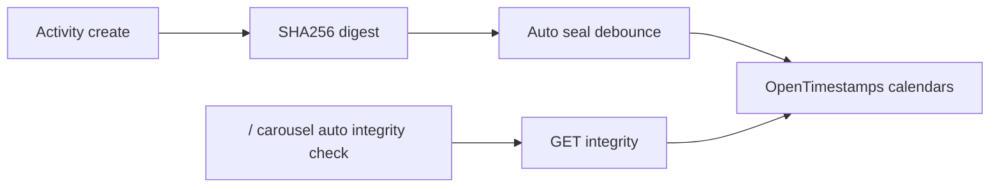

# Audit integrity (OpenTimestamps) on the public projects page

Free integrity sealing for municipal project activity history. Constituents check records on the existing public carousel (`/`) — no separate verify site and no paid gas chain.

**Future work (seal history, money docs, follow-the-money, mirrors):** see [`audit-integrity-roadmap.md`](./audit-integrity-roadmap.md).

## Model

| Piece | Where |
| --- | --- |
| Full activity text | Mongo `project_activities` (unchanged) |
| Per-event digest | `integrity_hash` (SHA-256 of canonical JSON) |
| Project master data digest | SHA-256 of canonical project fields (name, appropriation, codes, dates, etc.) |
| Merkle batch + OTS proof | `audit_integrity_batches` (activity leaves + project data leaves) |
| Public check | `GET /api/public/projects/:id/integrity` + panel on `/` |

Silent DB edits to **project fields** or **sealed activity rows** both fail the **automatic integrity check**. When project fields change, the UI lists **What changed** (sealed value → now). Normal app edits create a new activity and re-seal the current project snapshot (including a field snapshot for later diffs).



## Automatic sealing (no scheduler)

Sealing runs **when a new activity log row is created** (project create/update/delete, budget, obligation, disbursement, etc. all go through `ProjectActivityService.create`). Digests are hashed, then a short debounced background seal stamps pending digests with OpenTimestamps.

It is **not** a separate seal on every field update of a project — only when that mutation writes an activity log. Activity history is append-only; there is no activity update/delete path to re-seal.

No cron / Nitro scheduled task is required. Optional manual backup for recovery only:

```bash
npm run seal:audit-batches
```

## Public UX

Admin project details also has an **Integrity** tab (`read:ProjectIntegrity`) that reuses the same check UI.

On [`app/pages/index.vue`](../app/pages/index.vue), the integrity banner sits **under the project title / utilization badge** (above Code/Location/Budget) so constituents do not need to scroll:

- Public carousel: integrity panel is an **accordion closed by default** (status badges visible; tap to expand). Admin Integrity tab stays fully open.
- Integrity **auto-verifies** when the project is shown (optional **Recheck**)
- Helper: sealed project data and history have not been changed
- **Integrity timeline** (recorded → sealed → check result); when verification fails, an **Alteration timeline** + **What changed** field list
- Collapsed **How this seal works** (short easy explanation; auditor codes + optional OpenTimestamps steps tucked underneath)

## API

`GET /api/public/projects/:id/integrity`  
`GET /api/public/projects/:id/integrity?verify=1` — recompute digests, Merkle inclusion, OTS proof check

No auth. Response has counts/status only (no activity descriptions / PII).

Verify rebuilds the **full batch** Merkle tree (activity leaves + sorted project-data leaves), checks this project’s digests **and** current project master-data fingerprint against the sealed map, then validates the OpenTimestamps proof digest. Fresh stamps may show “Bitcoin confirmation pending” while still verifying as intact.

### What is sealed in project data

Canonical SHA-256 over: `id`, `name`, `implementingUnit`, `location`, `appropriation`, `year`, `services`, `remarks`, `code`, `startDate`, `endDate`, `latitude`, `longitude`.

## Tests

```bash
npm run test:unit
```

| Area | Path |
| --- | --- |
| Canonicalize + hash | `server/utils/auditIntegrity/__tests__/canonicalizeActivity.test.ts` |
| Merkle tree | `server/utils/auditIntegrity/__tests__/merkleTree.test.ts` |
| Public status mapping | `server/utils/auditIntegrity/__tests__/mapPublicIntegrityStatus.test.ts` |
| Public timeline | `server/utils/auditIntegrity/__tests__/buildPublicIntegrityTimeline.test.ts` |
| Batch verify (activities + project data) | `server/utils/auditIntegrity/__tests__/verifyBatchIntegrity.test.ts` |
| Project master-data hash | `server/utils/auditIntegrity/__tests__/canonicalizeProject.test.ts` |
| Verify detail badges | `app/constants/audit/__tests__/integrityVerifyDetail.test.ts` |
| Panel auto-check actions | `app/constants/audit/__tests__/integrityPanelActions.test.ts` |
| Field-level alterations | `server/utils/auditIntegrity/__tests__/diffProjectIntegritySnapshots.test.ts` |
| Alteration labels | `app/constants/audit/__tests__/integrityAlterationsCopy.test.ts` |
