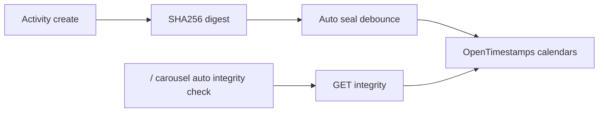

# Audit integrity (OpenTimestamps) on the public projects page

Free integrity sealing for municipal project activity history. Constituents check records on the existing public carousel (`/`) — no separate verify site and no paid gas chain.

**Future work + archive roadmap:** see [`audit-integrity-roadmap.md`](./audit-integrity-roadmap.md).

**Evidence archive:** Superadmin → **Integrity archive** (Mongo second cluster recommended on Vercel; also Vercel Blob, R2/S3/GCS, Local). New seals copy `manifest.json` + `.ots` outside the main DB when configured.

**COA offline pack:** Admin project → Integrity tab → **Download COA pack** (zip: README, `digests.csv`, per-batch `manifest.json` + `proof.ots`).

**Historical verify:** Auto-check re-verifies **every** sealed batch for the project (not only the latest). Pass → badge **All sealed history verified**.

**Actor / approvals (§4):** New activities seal with `actorType` / `actorId` / role / `source` (`canonVersion` v2). Money rows can link an `integrity_approvals` record; seals include `approvalId` + status + `requestId` when bound.

**Seal history + leaf packs (§5):** Integrity panel lists every past seal. Download a per-leaf inclusion pack (snapshot + hash + Merkle proof + root + `.ots`).

**Follow-the-money (§6):** Appropriation → budgets → obligations → disbursements with sealed badges on the Integrity panel.

## Model

| Piece | Where |
| --- | --- |
| Full activity text | Mongo `project_activities` (unchanged) |
| Per-event digest | `integrity_hash` (SHA-256 of canonical JSON; v2 includes actor fields) |
| Actor binding | `actor_type`, `actor_id`, `actor_role_snapshot`, `source`, `canon_version` |
| Approvals | `integrity_approvals` linked via money-row `approval_id` |
| Project master data digest | SHA-256 of canonical project fields (name, appropriation, codes, dates, etc.) |
| Financial record digests | SHA-256 + snapshot per additional budget / obligation / disbursement (`financial_data_hashes`) |
| Merkle batch + OTS proof | `audit_integrity_batches` (activity → project → financial leaves) |
| Public check | `GET /api/public/projects/:id/integrity` + panel on `/` |
| Leaf inclusion pack | `GET /api/public/projects/:id/integrity/leaves/:kind/:leafId/pack` |

Silent DB edits to **project fields**, **budget / obligation / disbursement rows**, or **sealed activity rows** fail the **automatic integrity check**. When fields change, the UI lists **What changed** (sealed value → now). Normal app edits create a new activity and re-seal the current project + money snapshots.



## Automatic sealing (no scheduler)

Sealing runs **when a new activity log row is created** (project create/update/delete, budget, obligation, disbursement, etc. all go through `ProjectActivityService.create`). Digests are hashed, then a short debounced background seal stamps pending digests with OpenTimestamps.

It is **not** a separate seal on every field update of a project — only when that mutation writes an activity log. Activity history is append-only; there is no activity update/delete path to re-seal.

No cron / Nitro scheduled task is required. Optional manual backup for recovery only:

```bash
npm run seal:audit-batches
```

## Public UX

Admin project details also has an **Integrity** tab (`read:ProjectIntegrity`) that reuses the same check UI.

On [`app/pages/index.vue`](../app/pages/index.vue), the integrity banner sits **under the project title / utilization badge** (above Code/Location/Budget) so constituents do not need to scroll:

- Public carousel: integrity panel is an **accordion closed by default** (status badges visible; tap to expand). Admin Integrity tab stays fully open.
- Integrity **auto-verifies** when the project is shown (optional **Recheck**)
- Helper: sealed project data and history have not been changed
- **Integrity timeline** (recorded → sealed → check result; latest actor on the recorded step); when verification fails, an **Alteration timeline** + **What changed** field list
- **Follow the money** trail and **Seal history** registry (with per-record verify pack download)
- Collapsed **How this seal works** (short easy explanation; auditor codes + optional OpenTimestamps steps tucked underneath)

## API

`GET /api/public/projects/:id/integrity`  
`GET /api/public/projects/:id/integrity?verify=1` — recompute digests, Merkle inclusion, OTS proof check  

`GET /api/public/projects/:id/integrity/leaves/:kind/:leafId/pack` — offline inclusion pack (`kind`: `activity` | `project` | `budget` | `obligation` | `disbursement`)

No auth. Integrity response has counts/status / trails only (no activity description PII dump). Leaf packs include the sealed snapshot needed for offline verify.

Verify rebuilds the **full batch** Merkle tree (activity leaves + sorted project-data leaves + financial leaves), checks this project’s digests, project master-data fingerprint, **and** money-row digests against the sealed maps, then validates the OpenTimestamps proof digest. Fresh stamps may show “Bitcoin confirmation pending” while still verifying as intact.

### What is sealed in project data

Canonical SHA-256 over: `id`, `name`, `implementingUnit`, `location`, `appropriation`, `year`, `services`, `remarks`, `code`, `startDate`, `endDate`, `latitude`, `longitude`.

### What is sealed in financial records

Per additional budget / obligation / disbursement: `id`, `projectId`, `kind`, `amount`, `reason`, `status`, `approvedBy`, `approvedDate`, plus `payee` for obligations and disbursements. When an `IntegrityApproval` is linked, also `approvalId`, `approvalStatus`, `requestId` (empty approval fields omit from canon so legacy digests stay stable). Stored on the batch as `financial_data_hashes` (hash + snapshot). Legacy batches without this field still verify project/activity leaves only.

## Tests

```bash
npm run test:unit
```

| Area | Path |
| --- | --- |
| Canonicalize + hash | `server/utils/auditIntegrity/__tests__/canonicalizeActivity.test.ts` |
| Merkle tree | `server/utils/auditIntegrity/__tests__/merkleTree.test.ts` |
| Public status mapping | `server/utils/auditIntegrity/__tests__/mapPublicIntegrityStatus.test.ts` |
| Public timeline | `server/utils/auditIntegrity/__tests__/buildPublicIntegrityTimeline.test.ts` |
| Batch verify (activities + project data) | `server/utils/auditIntegrity/__tests__/verifyBatchIntegrity.test.ts` |
| Project master-data hash | `server/utils/auditIntegrity/__tests__/canonicalizeProject.test.ts` |
| Verify detail badges | `app/constants/audit/__tests__/integrityVerifyDetail.test.ts` |
| Panel auto-check actions | `app/constants/audit/__tests__/integrityPanelActions.test.ts` |
| Field-level alterations | `server/utils/auditIntegrity/__tests__/diffProjectIntegritySnapshots.test.ts` |
| Financial record seals | `server/utils/auditIntegrity/__tests__/financialRecordIntegrity.test.ts` |
| Alteration labels | `app/constants/audit/__tests__/integrityAlterationsCopy.test.ts` |
| Archive settings + local path | `server/utils/settings/__tests__/normalizeIntegrityArchiveSettings.test.ts` |
| Archive evidence write | `server/utils/auditIntegrity/__tests__/archiveIntegrityEvidence.test.ts` |
| Local disk object store | `server/utils/objectStore/__tests__/localObjectStore.test.ts` |
| Provider cards (mongo / blob / …) | `app/constants/audit/__tests__/integrityArchiveProviders.test.ts` |
| COA offline zip pack | `server/utils/auditIntegrity/__tests__/buildCoaIntegrityPackZip.test.ts` |
| Historical batch aggregate | `server/utils/auditIntegrity/__tests__/aggregateHistoricalBatchVerify.test.ts` |
| History scope / verified label | `app/constants/audit/__tests__/integrityHistoryScope.test.ts` |
| Actor canon v1/v2 | `app/constants/audit/__tests__/integrityActor.test.ts` |
| Approval constants | `app/constants/audit/__tests__/integrityApproval.test.ts` |
| Approval fields on money seals | `server/utils/auditIntegrity/__tests__/attachMoneyApprovalSealFields.test.ts` |
| Follow-the-money trail | `server/utils/auditIntegrity/__tests__/buildFollowTheMoneyTrail.test.ts` |
| Seal history rows | `server/utils/auditIntegrity/__tests__/buildSealHistoryEntries.test.ts` |
| Leaf inclusion pack | `server/utils/auditIntegrity/__tests__/buildLeafInclusionPack.test.ts` |
